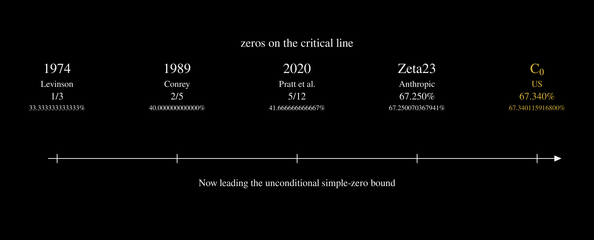

# Simple critical-line zeros, checked at two rationals



This tree carries two unconditional Lean 4 theorems about the Riemann zeta function. Each lower-bounds the number of zeros that are simple and lie on the critical line. The wider rational is proved in `n0simple/`. The tighter rational is proved in `c0/` by spending unused credit in that same elimination. The analytic engine underneath both is the imported package `zeta23/`.

Toolchain `leanprover/lean4:v4.33.0-rc2`. Mathlib comes from `https://github.com/leanprover-community/mathlib4` at `51e6992efd06126df61a496bebf8f49482a4e129`, the revision named in `zeta23/lakefile.toml`.

The Riemann hypothesis stays open. These theorems are asymptotic density bounds.

## The four statements

Write $`N(T_1,T_2)`$ for the nontrivial zeros with $`T_1 \lt \mathrm{Im} \rho \le T_2`$, counted with multiplicity, and $`N_0^s(T_1,T_2)`$ for those among them that are simple and lie on $`\mathrm{Re} \rho = 1/2`$.

`N0Simple.Assembly.Endgame.dyadic_target` produces a height $`T_0`$ such that every $`T \ge T_0`$ satisfies

```math
\frac{6734}{10000}\,N(T,2T)\le N_0^s(T,2T).
```

`N0Simple.Assembly.Endgame.cumulative_target` is the long-interval form: for every $`\varepsilon > 0`$ there is a height beyond which

```math
\Bigl(\frac{6734}{10000}-\varepsilon\Bigr)\,N(0,T)\le N_0^s(0,T).
```

`C0.DyadicTarget.dyadic_target_c0` has the same dyadic shape at a longer rational. For all sufficiently large $`T`$,

```math
\frac{673401159168}{10^{12}}\,N(T,2T)\le N_0^s(T,2T).
```

`C0.DyadicTarget.cumulative_target_c0` is the matching cumulative form: for every $`\varepsilon > 0`$ and all sufficiently large $`T`$,

```math
\Bigl(\frac{673401159168}{10^{12}}-\varepsilon\Bigr)\,N(0,T)\le N_0^s(0,T).
```

In decimal, the two headline proportions are $`0.6734`$ and $`0.673401159168`$. The second one is exactly twelve digits. It is the truncation of the frozen projection

```math
\frac{338173116}{502186715} = 0.673401159168\ldots,
```

which is strictly larger than $`6734/10000`$. `C0.C0LtProjected.c0_lt_projectedRatio` is a `norm_num` proof that the twelve-digit rational itself sits strictly under that projection. The seven-digit display $`0.6734012`$ is a different rounding and is not the theorem. This tree has no library at $`673/1000`$.

### Same proof, two propositions

`N0Simple.Assembly.Endgame.dyadic_target` and `C0.DyadicTarget.dyadic_target_c0` lower-bound one counting function, $`N_0^s`$: the nontrivial zeros whose multiplicity is exactly $`1`$ and which lie on the critical line. Each dyadic form states that inequality at its own constant, with the constant unreduced by $`\varepsilon`$. The constants differ by the positive rational

```math
\frac{673401159168}{10^{12}}-\frac{6734}{10000}=\frac{1159168}{10^{12}}=\frac{283}{244140625},
```

and $`0 \lt 283/244140625`$. For every real $`N \ge 0`$ and every real $`M`$, the inequality at $`673401159168/10^{12}`$ implies the inequality at $`6734/10000`$. The converse is false for a general pair. When $`0 \lt N`$ and $`M = (6734/10000)\,N`$, the shorter inequality holds and the twelve-digit inequality fails. Specializing $`N`$ to $`N(T,2T)`$ and $`M`$ to $`N_0^s(T,2T)`$ makes the twelve-digit dyadic sentence the stronger requirement on that nonnegative count. The two sentences are two propositions. The rational $`673401159168/10^{12}`$ is a different rational from $`6734/10000`$.

The constant $`c_0 = 673401159168/10^{12}`$ is the twelve-digit downward truncation of the projection

```math
\Pi=\frac{338173116}{502186715}=0.67340115916845789\ldots.
```

`C0.C0LtProjected.c0_lt_projectedRatio` is the comparison $`c_0 \lt \Pi`$. The value $`\Pi`$ itself is not an exported lower bound. The elimination accepts a constant strictly under $`\Pi`$, and `dyadic_target_c0` is instantiated at $`c_0`$. The local certificate remains the N0Simple certificate on the 132-point block.

These sentences bound $`N_0^s`$. The counting function $`N_0`$ sums the multiplicities of the zeros on the critical line in the same ordinate window. A zero of multiplicity exactly $`1`$ on the line is counted by both. A zero of higher multiplicity on the line contributes that multiplicity to $`N_0`$ and contributes nothing to $`N_0^s`$.

## Where each package stops

| Package | Lean entry | Proportion it exports |
|---|---|---|
| `zeta23/` | Zeta23 theorems A–E | Montgomery–Taylor simple-zero proportion $`67.2500703679\ldots\%`$, imported as the analytic foundation |
| `n0simple/` | `N0Simple.Assembly.Endgame` | $`6734/10000 = 67.34\%`$, dyadic and cumulative |
| `c0/` | `C0.DyadicTarget` | $`673401159168/10^{12}`$, same elimination, larger admissible constant |

`n0simple/` is the corrected-window proof. `c0/` requires that package and `zeta23/`; it does not rebuild the finite certificate.

## Scale against other hypothesis-free Lean bounds

The rows below are hypothesis-free, end-to-end Lean conclusions. Conditional arguments and externally certified numerical candidates are left out.

| Bound | Local pattern | Development |
|---|---:|---|
| $`67.2500703679\ldots\%`$ | baseline | [Anthropic Zeta23](https://github.com/anthropics/zeta-23-lean) |
| $`67.2737334504\ldots\%`$ | three points | [`teal-sea/zeta-lab`](https://github.com/teal-sea/zeta-lab) |
| $`67.2847019767\ldots\%`$ | four points | [`teal-sea/zeta-lab`](https://github.com/teal-sea/zeta-lab) |
| $`67.34\%`$ | seven points | **N0Simple**, in `n0simple/` |

Among those rows, the $`67.34\%`$ theorem is, to our knowledge at the time of release, the strongest publicly available hypothesis-free end-to-end Lean bound of this kind. The twelve-digit theorem in `c0/` is a sharper admissible constant on that same proof.

### Zeta23 theorems for the same count

The row $`67.2500703679\ldots\%`$ is the decimal of $`\mathrm{HD}(1)`$, the constant of `thmD₀_simple_mult` in `zeta23/Zeta23/ThmD/Mult.lean` (around line 500). That constant is $`\mathrm{HD}(1)`$. The constant $`2/3`$ belongs to `thmB₀_mult`.

Three theorems in `zeta23/` lower-bound a count comparable with $`N_0^s`$.

| Theorem | Statement | Constant and shape |
|---|---|---|
| `thmB₀_mult` | `zeta23/Zeta23/FinalMult.lean`, around line 350 | $`2/3`$, shape $`(2/3-\varepsilon)`$ |
| `thmD₀_simple` | `zeta23/Zeta23/ThmD/Final.lean`, around line 119 | $`2c_1^{*}-1 \approx 0.50659`$, Cauchy–Schwarz shape $`(2c_1^{*}-1-\varepsilon)`$ |
| `thmD₀_simple_mult` | `zeta23/Zeta23/ThmD/Mult.lean`, around line 500 | $`\mathrm{HD}(1) \approx 0.672500703679`$, shape $`(\mathrm{HD}(1)-\varepsilon)`$ |

`thmD₀_simple_mult` is the simple-zero headline in that library. In the Lean statement the Cauchy–Schwarz constant is `2 * cStar 1 - 1`, and the headline constant is `HD 1`. Their sizes stand in this order:

```math
2c_1^{*}-1 \lt \frac{2}{3} \lt \mathrm{HD}(1) \lt \frac{6734}{10000} \lt \frac{673401159168}{10^{12}}.
```

So $`2/3`$ is a weaker lower bound than $`\mathrm{HD}(1)`$, and $`2c_1^{*}-1 \approx 0.50659`$ is weaker still. The same real $`\mathrm{HD}(1)`$ is the constant of `thmD₀` in `zeta23/Zeta23/ThmD/Final.lean` (around line 105), which bounds $`N_0^{*}`$, the distinct zeros on the critical line. The simple-zero theorem uses that same value of $`\mathrm{HD}(1)`$.

The N0Simple constant $`6734/10000`$ lies above $`\mathrm{HD}(1)`$. The constant $`c_0`$ lies above $`6734/10000`$ by $`283/244140625`$. The lower bound that increases is the lower bound for $`N_0^s`$. The dyadic shape tightens with the constant. Each of the three Zeta23 theorems has the form $`(c-\varepsilon)`$ for every $`\varepsilon`$ with $`0 \lt \varepsilon`$. The dyadic theorems `dyadic_target` and `dyadic_target_c0` state the inequality with no $`\varepsilon`$.

The $`67.3\%`$ theorem kept the Montgomery–Taylor window. Its finite step has six gap variables and twenty-one pair distances. A direct subdivision of that box is too large to elaborate as a proof term, so the argument used a sparse phase-affine stand-in: a nonnegative 15-edge sub-objective, twelve reusable one-dimensional kernel phases, exact rational LP and Farkas witnesses at the leaves, and a certificate tree of 1,063 nodes and 532 leaves.

N0Simple keeps the retained-defect viewpoint and changes the analytic window. The kernel is corrected, the gap pressure depends on position, and the local inequality and the trace inequality are written against one canonical Gram defect before that defect is eliminated. The certificate is the larger hybrid described below, and the corrected window is realized inside the Zeta23 framework.

## One elimination, spent at two rationals

An admissible window $`v`$ determines a global trace rate $`r(v)`$ and a normalized local kernel $`K_v`$. On six nonnegative consecutive gaps, set $`y_0 = 0`$ and $`y_j = g_0 + \cdots + g_{j-1}`$. The frozen local inequality has the shape

```math
\gamma \le \sum_{i \lt j} a_{ij} K_v(y_j-y_i)^2 + \sum_{k=0}^{5} b_k g_k.
```

The pair loads are nonnegative and meet a span-capacity identity at every lag:

```math
\sum_{i=0}^{6-s} a_{i,i+s} = 2 \qquad (1 \le s \le 6).
```

The pressure coordinates are a single rational mass:

```math
\sum_{k=0}^{5} b_k = \frac{93}{23000}.
```

Those two laws are what make translated copies summable. Pair energy is charged to the block Gram matrix. The linear gap term becomes a diameter pressure with an exact budget.

The frozen block has 132 points and 126 translated seven-point windows. Its finite gain is

```math
G = 126 \cdot \frac{1579}{200000} = \frac{99477}{100000} \lt 1.
```

The comparison $`\min(1,E) \le D`$ turns accumulated local kernel energy into the spectral defect $`D`$, with no nonlinear Gram-profile loss. Once the local side and the trace side name the same canonical Gram defect, the bookkeeping is

```math
rN + D \le S, \qquad GS \le mD + PN + o(N),
```

and removing $`D`$ leaves

```math
S \ge \frac{mr - P}{m - G}\, N - o(N).
```

N0Simple instantiates this at $`6734/10000`$. The package `c0` instantiates it at $`673401159168/10^{12}`$.

### The credit that `c0` spends

`c0` keeps `N0Simple.Assembly.LocalAsymptotic.eventually_canonical_local_inequality`. The certificate, the window, and the block stay as they are. What changes is the constant the elimination is allowed to charge.

`C0.MarginAtC.margin` is that credit, as a function of a real parameter $`c`$:

```math
\mathrm{blockSize}\cdot\mathrm{correctedRateFloor}
- \mathrm{windowCount}\cdot\mathrm{pressure}
- c\,(\mathrm{blockSize}-\mathrm{blockGain}).
```

`C0.MarginAtC.margin_eq` factors the expression:

```math
(\mathrm{blockSize}-\mathrm{blockGain})\,(\mathrm{projectedRatio}-c).
```

The first factor is positive. `C0.MarginAtC.margin_pos_of_lt_projectedRatio` therefore says the credit is positive for every $`c \lt \mathrm{projectedRatio}`$. At $`c =`$ `N0Simple.Route.target` the credit is the existing `eliminationMargin`.

`C0.DyadicOfLocal.dyadic_of_local_of_lt_projectedRatio` is the parameterized form of `Headline.dyadic_target_of_local`. Any such $`c`$, fed the N0Simple local inequality, yields

```math
c\, N(T,2T) \le N_0^s(T,2T)
```

for all sufficiently large $`T`$. `dyadic_target_c0` is that lemma at $`673401159168/10^{12}`$, with `c0_lt_projectedRatio` supplying the comparison and the N0Simple inequality supplying `hlocal`. `DyadicTarget` is the module that exports both final `c0` theorems.

The reusable layout is the **window–energy–pressure–defect interface**. Informally, *window–subaction–defect duality* names the same layout. In this project, “subaction” means the calibrated finite-range local certificate. It is a local name for that object, and it does not introduce a general notion of calibrated subaction.

## What was already in the literature, and what this tree adds

The analytic number theory, the trace asymptotics, the zero-side decomposition, and the dyadic-to-cumulative endgame come from Anthropic’s [`zeta-23-lean`](https://github.com/anthropics/zeta-23-lean). The retained spectral defect, and the decision to look at seven consecutive zeros, come from [`ainta/zeta-simple-zeros`](https://github.com/ainta/zeta-simple-zeros). Position-dependent gap pressure comes from [`sxuff/zeta-positioned-pressure`](https://github.com/sxuff/zeta-positioned-pressure); [`AMTOPA/zeta-exact-pressure-673262`](https://github.com/AMTOPA/zeta-exact-pressure-673262) kept that pressure exact under shifted-block averaging. The 17-term corrected window, the pair loads, and the pressure data used here were found in [`AMTOPA/zeta-exact-pressure`](https://github.com/AMTOPA/zeta-exact-pressure).

Retained defect, seven-point certificates, and positioned pressure were not invented in this tree. The formal work added here is the following.

The corrected window is a Lean object: sixteen exact rational Fourier modes, with proved identities for the trace rate and the local kernel. Counting, the spectral-defect lift, and the removal of the shared canonical defect are separate modules with an explicit interface. The 132-point assembly is cap-one, so it never calls the nonlinear scalar-Gram profile used by the numerical exact-pressure projection. The finite certificate is hybrid and exact: affine envelopes, rational LP and Farkas witnesses, interval-Hessian basins with LDL witnesses, and reflected subboxes. Those pieces close in Lean, with no hypothesis, at both the dyadic and the cumulative form of $`6734/10000`$. The package `c0` then charges the same elimination at $`673401159168/10^{12}`$.

The numerical exact-pressure project certifies slightly stronger local inputs. N0Simple keeps rational slack and a different block length so that every analytic transfer, every finite certificate check, the spectral step, and the final deduction about zeta are Lean proofs.

## Constants locked in the source

| Quantity | Value |
|---|---|
| Window corrections | 16 exact rational integer Fourier modes |
| Pressure | $`93/23000`$ |
| Endpoint gain | $`79/10000`$ |
| Transfer reserve | $`1/200000`$ |
| Finite gain | $`1579/200000`$ |
| Block size | 132 |
| Window count | 126 |
| Block gain | $`99477/100000 \lt 1`$ |
| Rate floor | $`336093/500000`$ |
| N0Simple headline | $`6734/10000`$ |
| `c0` headline | $`673401159168/10^{12}`$ |

## Module map

Paths are from the repository root. `n0simple/N0Simple.lean` imports only the production route.

**Window.** `n0simple/N0Simple/Window/SharedPhase.lean` and `QuadraticLoss.lean` give the common-phase kernel and the diagonal window loss. `CorrectedRate.lean` freezes the profile and proves the rational rate floor. `Profile.lean`, `Realization.lean`, `SharpBridge.lean`, `FunctionalBridge.lean`, and `RateBridge.lean` realize that profile at height and pass its endpoint rate to a legal parameter below one.

**Local inequality.** `n0simple/N0Simple/Local/CorrectedWeight.lean` and `SharedFirst.lean` enclose the local weight and its first two derivatives by rationals. The checker modules under `n0simple/N0Simple/Local/` show that the affine-envelope, LP/Farkas, convex-Hessian, and hybrid checkers are sound. `n0simple/N0Simple/Local/CertificateData/` holds the generated proof-carrying data. `Endpoint.lean` derives the universal seven-point inequality.

**Block and elimination.** `PositionedCounting.lean` and `n0simple/N0Simple/Spectral/DefectLift.lean` are the profile-independent counting step and the cap-one spectral step. `Local/Block/SevenPointEnergy.lean`, `Assembly/Block.lean`, `Assembly/GlobalBlock.lean`, and `Assembly/LocalAsymptotic.lean` produce the retained-defect inequality on the 132-point block. `Assembly/TraceEndgame.lean`, `Elimination.lean`, `Headline.lean`, and `Endgame.lean` identify the shared defect, eliminate it, and export `dyadic_target` and `cumulative_target`.

**Sharper constant.** `c0/C0/MarginAtC.lean` defines `margin` and proves the factorization and the positivity statement. `c0/C0/C0LtProjected.lean` proves `c0_lt_projectedRatio`. `c0/C0/DyadicOfLocal.lean` proves `dyadic_of_local_of_lt_projectedRatio`. `c0/C0/DyadicTarget.lean` applies that lemma at $`673401159168/10^{12}`$.

## Census of the frozen certificate

The semantic tree has 6,405 nodes and 3,203 leaves: 2,531 LP optimum leaves, 634 Farkas infeasibility leaves, 38 interval-Hessian basins, 21 directly checked LDL witnesses, and 17 reflected-subbox reuses. No leaf is open.

The affine layer stores 19,673 references to 9,092 distinct analytic cells. Each value or derivative enclosure is checked once and then shared. The 21 direct convex witnesses use 5,770 second-derivative cells. Generated layers are split into independent modules so an expensive check can be resumed.

## Checking it

Shipped sources are the Lean files under `n0simple/`, `zeta23/`, and `c0/`, plus `n0simple/certificate.json`, `n0simple/affine_cells.json`, and `n0simple/convex_cells.json`. Build products — `.lake/`, `*.olean`, `*.ilean`, generated `*.c`, and logs — are not part of the source.

Requirements: Python 3.9 or later, Lean `v4.33.0-rc2` through elan, and the sibling directories `zeta23/` and `n0simple/`.

Some exact rational checks in the $`6734/10000`$ certificate need a lot of memory, so the modules are built one resumable step at a time. From `n0simple/`:

```bash
python3 scripts/build_lean.py
lake env lean N0Simple/Audit.lean
```

Successful modules are skipped. Hybrid-leaf checks run with a concurrency cap, because exact rational LDL reduction is memory-heavy.

To regenerate the proposal data and then rebuild, still from `n0simple/`:

```bash
python3 scripts/replay_hybrid.py certificate.json
python3 scripts/build_affine_cells.py \
  certificate.json affine_cells.json --workers 17 --max-depth 35
python3 scripts/build_convex_cells.py \
  certificate.json convex_cells.json --workers 21
python3 scripts/generate_lean_certificate.py \
  certificate.json affine_cells.json N0Simple/Local/CertificateData \
  --convex convex_cells.json --shards 96
python3 scripts/build_profile_certificate.py N0Simple/Window/ProfileData.lean
python3 scripts/build_lean.py
```

The Python scripts and the JSON files propose data. They are not trusted. The Lean checker recomputes the analytic enclosures, the coverage claims, the rational identities, and the final arithmetic that the theorems use.

For the twelve-digit constant, `c0/lakefile.toml` requires `../n0simple` and `../zeta23`. The manifest `c0/lake-manifest.json` already records those pins. From `c0/`:

```bash
lake update
lake build
```

`lake update` materializes the pinned Mathlib checkout. `lake build` builds the default library `C0`.

## What the kernel assumes

The production route has no `sorry`, no `admit`, no project-specific axiom, no `native_decide`, no unsafe proof, and no external numerical oracle. Generated equalities reduce in the kernel (`with_unfolding_all rfl`). An axiom audit of that route reports only

```text
propext, Classical.choice, Quot.sound
```

Apache-2.0. See [`LICENSE`](LICENSE).
